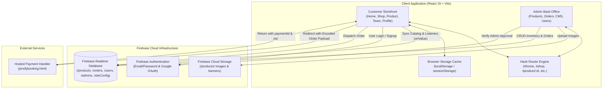

# JERSIFY — Wear The Game

[](https://react.dev/)
[](https://vite.dev/)
[](https://firebase.google.com/)
[](https://oxc.rs/)
[](#license)

> **A mobile-first football jersey e-commerce platform featuring real-time cloud inventory synchronization, interactive kit customization, curated club hubs, and a comprehensive back-office operations dashboard.**

---

## 1. Project Title and Introduction

- **Project Name:** JERSIFY (Wear The Game)
- **One-Line Description:** A high-performance, mobile-first e-commerce web application engineered for football jersey enthusiasts, powered by React 19, Vite, and Firebase.
- **Problem It Solves:** Football fans often struggle with cluttered, desktop-centric sportswear stores that lack clear jersey edition categorization (Fan Version vs. Player Issue vs. Retro Classic), seamless mobile interactions, squad name/number personalization, and flexible local payment workflows (such as Partial Cash on Delivery). Jersify addresses these issues with a Figma-accurate mobile UX, instant client caching, real-time database synchronization, and an integrated store administration system.
- **Intended Users:** Football jersey collectors, sports fans purchasing authentic kits, and merchandise store administrators managing orders and catalog inventory.
- **Current Development Status:** **Functional Prototype / MVP**. The core storefront workflows, customer account management, and back-office admin dashboard are fully implemented and integrated with Firebase Realtime Database and Firebase Storage. External payment settlement relies on a hosted checkout redirect flow.

---

## 2. Project Overview

**JERSIFY** is an e-commerce platform specifically tailored for football apparel culture. It delivers an app-like mobile web experience inspired by modern streetwear and sportswear design systems.

### Primary Use Cases

1. **Catalog Exploration & Discovery:** Browse authentic match kits, retro grails, and lifestyle football apparel categorized by team, season, and edition.
2. **Jersey Personalization:** Select sizing (S–XXL), preview edition details, and specify custom player names and squad numbers.
3. **Bag & Order Management:** Add items to cart with live quantity adjustment, apply promotional coupon codes, calculate split shipping fees, and track order fulfillment history.
4. **Flexible Checkout:** Support for online payments (UPI, Cards) as well as **Partial Cash on Delivery (Partial COD)**, which collects courier logistics costs upfront while leaving the garment balance due upon delivery.
5. **Back-Office Store Administration:** Manage store banners, update team profiles, curate shopping catalog ordering, add/edit/delete product inventory, and update order statuses in real time.

---

## 3. Key Features

### ✅ Implemented Features

#### 📱 Mobile-First Customer Experience
- **Figma-Aligned Responsive UI:** Tailored 393px-optimized mobile layout with smooth transitions, touch-friendly touch targets, and fixed bottom navigation (`Home`, `Shop`, `Bag`, `Profile`).
- **Touch-Swipe Product Gallery:** Smooth touch-swipe carousel on product detail pages with slide indicators and full-screen image inspection.
- **Dynamic Club Hubs:** Dedicated team profile views (`#team/:name`) featuring club crests, stadium details, founding year, and club-specific jersey collections (FC Barcelona, Real Madrid, Argentina, Manchester City, Liverpool, AC Milan, Bayern Munich, Juventus).
- **Category & Edition Segmentation:** Instant filtering between **Fan Versions**, **Player Issue / Player Versions**, and **Retro Editions**, plus curated thematic tags (World Cup, Usual Wear).
- **Instant Client-Side Search:** Real-time filtering across jerseys by name, club, edition, and category tags.

#### 🛒 Cart, Coupons & Checkout
- **Persistent Shopping Bag:** Cart items and quantities are synchronized to browser storage (`localStorage`) and badge counters update instantly across views.
- **Discount Coupon Engine:** Configured discount codes with support for flat discounts and percentage deductions:
  - `JERSIFY100`: ₹100 flat discount
  - `PORTU`: ₹100 flat discount
  - `DHRUBOTARA50`: ₹50 flat discount
  - `JERSIFY99`: 20% discount
- **Smart Shipping Tiers:** Dynamic delivery fees (Free shipping for orders over ₹1,999; flat ₹69 shipping otherwise).
- **Partial COD Payment Model:** Split payment structure where ₹120 courier charge + 50% product price is paid upfront, and the remaining 50% is collected on delivery.
- **Saved Address Book:** Multi-address management with default selection, stored both in Firebase Realtime Database and cached locally for rapid checkout.
- **Order Placement & Tracking:** Order records generated with unique identifiers (`JRS-XXXXXX`), tracking items, pricing breakdowns, payment mode, and order fulfillment status.

#### 🔐 Authentication & Customer Profiles
- **Dual Authentication Modes:** Email/Password registration and login alongside one-click **Google Sign-In Popup** via Firebase Authentication.
- **Profile Data Hydration:** Proactive user profile pre-fetching and caching in `localStorage` and `sessionStorage` for instant navigation without loading delays.
- **Order History Portal:** View chronological order history with order state tags (`pending`, `confirmed`, `shipped`, `delivered`, `cancelled`).

#### 🛠️ Back-Office Admin Dashboard (CMS & Operations)
- **Protected Admin Gateway:** Dedicated administrative authentication route (`#admin-login`) enforcing status and role approval (`isAdmin === true` or `role === "Super Admin"`) stored in the database.
- **8 Administrative Control Modules:**
  1. **Images & CMS Manager:** Update hero slider banners, spotlight banners, and brand logos with direct upload to Firebase Storage.
  2. **Shopping Page Order:** Customize display ordering of Fan, Player, and Retro collections.
  3. **Club Configuration:** Manage club metadata (name, stadium, founded year, crest URL, banner URL, club bio).
  4. **Product Inventory CRUD:** Create, update, and delete jersey listings with pricing, sale prices, sizes (`s`, `m`, `l`, `xl`, `xxl`), category tags, badges, and image galleries.
  5. **Category Manager:** Create and manage product categories and tags.
  6. **Order Fulfillment Hub:** View customer orders, filter by fulfillment status, inspect line items and customer contact info, and update order statuses.
  7. **Shopping / Procurement List:** Automated procurement list generator for warehouse picking and fulfillment packaging.
  8. **User Directory:** Inspect registered customer profiles, roles, and administrative applicants.

---

### 🟡 Partially Implemented / External Integrations
- **Payment Gateway Processing:** The application calculates order totals and redirects to an external hosted booking gateway (`/jersifybooking.html` locally or `https://waveridrentals.vercel.app/jersifybooking.html` in production) passing base64 order metadata and query parameters. Successful returns trigger status updates in the Realtime Database via query parameter callbacks (`paymentId`, `oid`).
- **Offline / Test Mode Fallbacks:** Login and Google Auth include client-side fallback profiles to maintain UI availability during network disconnects or missing backend permissions.

---

### ⏳ Planned Features (Future Roadmap)
- Server-side order creation and cryptographically verified webhook handlers (Razorpay / Cashfree HMAC verification).
- Automated customer SMS and WhatsApp notifications on order dispatch.
- Customer jersey reviews and star rating submission portal.
- International shipping rates and multi-currency selector.
- Automated end-to-end testing pipeline.

---

## 4. Screenshots and Demo

### Visual Assets Available in Repository
The repository includes high-resolution UI and promotional assets within `public/figma/` and `src/assets/`:
- `public/figma/heroBanner1.png` — Hero showcase banner
- `public/figma/wearYourIdentity.png` — Brand identity section banner
- `public/figma/goodOldKits.png` — Retro and vintage collection graphic
- `public/figma/curatedSeasonPkg.png` — Seasonal curated package showcase
- `public/figma/activities.png` — Lifestyle editorial asset
- `public/jersify-logo.svg` — Brand crest logo

### Recommended Screenshots for Recruiter Review
To review the live application interface, capture screenshots of the following core user journeys:

| View | Description | Suggested Capture |
| :--- | :--- | :--- |
| **Mobile Home View** | Hero slider, club crest selector, and editorial banners | Capture `/#home` on mobile viewport (393px) |
| **Catalog & Filter View** | Category tabs (Fan, Player, Retro), search bar, and grid | Capture `/#shop` |
| **Product Customization** | Touch gallery, size selector, and player name/number inputs | Capture `/#product/barca-home-2627` |
| **Cart & Coupon Drawer** | Slide-out drawer with coupon discount calculation | Open Bag drawer with `JERSIFY100` applied |
| **Customer Orders Hub** | Order history with status tags and item breakdowns | Capture `/#orders` |
| **Admin Operations Suite**| Back-office dashboard showing product CRUD and order management | Capture `/#admin-dashboard` |

### Live Demo & Repository
- **Source Code Repository:** [https://github.com/myselfrakib/Jersify](https://github.com/myselfrakib/Jersify)
- **External Payment Gateway Host (Verified from source):** `https://waveridrentals.vercel.app/jersifybooking.html`
- *Note: Production hosting URL for the main frontend should be verified with the maintainer.*

---

## 5. Technology Stack

### Frontend Core
| Technology | Version | Purpose in Project |
| :--- | :--- | :--- |
| **React** | `19.2.8` | Core UI library for component hierarchy, state management, and lifecycle hooks |
| **React DOM** | `19.2.8` | DOM rendering and portal mounting |
| **Vite** | `8.3.0` | Development server with Hot Module Replacement (HMR) and optimized ESBuild/Rollup bundling |
| **JavaScript (ESM)** | ES2022+ | Modern modular JavaScript syntax |
| **CSS3** | Vanilla CSS | Custom responsive design system, animations, slide-out drawers, and layout rules |

### BaaS & Cloud Services
| Technology | Version | Purpose in Project |
| :--- | :--- | :--- |
| **Firebase App** | `12.19.0` | Client SDK initialization |
| **Firebase Auth** | `12.19.0` | Email/Password credentials and Google OAuth popup authentication |
| **Firebase Realtime Database** | `12.19.0` | Real-time NoSQL data synchronization for products, orders, users, and CMS site config |
| **Firebase Storage** | `12.19.0` | Cloud binary storage for uploaded product images and promotional banners |
| **Firebase Analytics** | `12.19.0` | Client-side user telemetry and event reporting |

### UI Libraries & Tooling
| Technology | Version | Purpose in Project |
| :--- | :--- | :--- |
| **Lucide React** | `^1.52.0` | Lightweight, scalable vector iconography |
| **Canvas Confetti** | `^1.9.4` | Interactive micro-animation triggers upon order completion |
| **Oxlint** | `^1.81.0` | High-performance Rust-based linter enforcing React hook and component best practices |
| **Google Fonts** | Hosted | Typography system: *Karla*, *Inter*, and *Josefin Sans* |

---

## 6. Architecture and Project Structure

### System Architecture Diagram



### Directory Structure

```text
jersify-app/
├── public/
│   ├── figma/                     # Static UI assets and banners from design specs
│   ├── favicon.svg                # Application browser icon
│   ├── jersify-logo.svg           # Brand crest SVG
│   └── jersify-wordmark.png       # Brand typography wordmark
├── src/
│   ├── assets/                    # Bundled SVGs, vectors, and icons
│   │   ├── hero.png
│   │   ├── react.svg
│   │   ├── svgIcons.js            # Centralized SVG icon registry
│   │   └── vite.svg
│   ├── components/                # Modular React UI components
│   │   ├── AdminDashboard.jsx     # Full back-office management portal (8 modules)
│   │   ├── AdminLoginPage.jsx     # Admin authentication with approval gatekeeper
│   │   ├── AuthModal.jsx          # Quick authentication modal overlay
│   │   ├── BottomNav.jsx          # Mobile bottom navigation bar
│   │   ├── CartDrawer.jsx         # Slide-out bag with coupon & shipping calculation
│   │   ├── CheckoutModal.jsx      # Alternative checkout modal workflow
│   │   ├── ClubFilter.jsx         # Club filter carousel
│   │   ├── EditorialSection.jsx   # Curated seasonal campaign section
│   │   ├── FigmaCheckoutPage.jsx  # Dedicated checkout screen with Partial COD
│   │   ├── FigmaExactView.jsx     # Mobile home landing view
│   │   ├── FigmaLoginPage.jsx     # Customer sign-in (Email & Google OAuth)
│   │   ├── FigmaOrdersPage.jsx    # Real-time order history tracking
│   │   ├── FigmaProductPage.jsx   # Product details, touch swipe & size selection
│   │   ├── FigmaProfilePage.jsx   # User account hub and settings
│   │   ├── FigmaSavedAddressesPage.jsx # Multi-address book management
│   │   ├── FigmaShopPage.jsx      # Full shopping catalog with live search & tabs
│   │   ├── FigmaSignupPage.jsx    # Customer registration screen
│   │   ├── FigmaTeamPage.jsx      # Club hub (Barcelona, Real Madrid, etc.)
│   │   ├── Footer.jsx             # Site footer
│   │   ├── GoodOldKitsSection.jsx # Vintage retro jersey showcase
│   │   ├── HeroCarousel.jsx       # Hero promotional slider
│   │   ├── ImageWithSpinner.jsx   # Image loader with skeleton fallback
│   │   ├── LifestyleSection.jsx   # Lifestyle football culture showcase
│   │   ├── Navbar.jsx             # Top header bar
│   │   ├── NotBasicBanner.jsx     # Spotlight promo banner
│   │   ├── ProductCard.jsx        # Reusable product grid card
│   │   ├── ProductModal.jsx       # Quick preview modal
│   │   ├── UserProfileModal.jsx   # Account modal dialog
│   │   ├── WholePageSpinner.jsx   # Route transition loading spinner
│   │   └── WishlistDrawer.jsx     # Saved items drawer with quick-add
│   ├── data/                      # Initial fallback datasets
│   │   ├── categoriesData.js      # Default categories (WorldCup, Usual Wear)
│   │   ├── clubsData.js           # Club metadata and asset mappings
│   │   └── initialProducts.js     # Default jersey seed inventory
│   ├── App.css                    # Component layout styles
│   ├── App.jsx                    # Root router, global state, & hash controller
│   ├── firebase.js                # Firebase App, Auth, RTDB & Storage initialization
│   ├── index.css                  # Global design tokens, typography, & reset rules
│   └── main.jsx                   # React 19 root entry point
├── .gitignore                     # Git tracking exclusions
├── .oxlintrc.json                 # Oxlint configuration schema
├── index.html                     # HTML5 entry with Google Fonts preconnections
├── package.json                   # Project dependencies and npm scripts
└── vite.config.js                 # Vite bundler configuration
```

---

## 7. How It Works

### 1. Catalog Browsing & Dual-Layer Caching Flow
1. Upon initial load, `App.jsx` and components immediately render seed data from `sessionStorage` or local static files (`initialProducts.js`, `categoriesData.js`) to provide zero-latency first paint.
2. Background Firebase listeners (`onValue(ref(rtdb, 'products'))`) asynchronously fetch live cloud data. When updates arrive, React state re-renders the UI and updates `sessionStorage`.

### 2. Hash-Based Deep Linking & Scroll Restoration
1. Navigation is handled through URL hash routes (`#home`, `#shop`, `#product/:id`, `#team/:name`, `#profile`, `#orders`, `#addresses`, `#checkout`, `#admin-login`, `#admin-dashboard`).
2. Hash changes trigger route state updates in `App.jsx`.
3. An active scroll listener records `window.scrollY` per route into `sessionStorage`, automatically restoring scroll positions when the user navigates back.

### 3. Personalization & Shopping Bag Logic
1. When browsing a product, users can select jersey sizes (`S`, `M`, `L`, `XL`, `XXL`) and enter custom squad names and numbers.
2. In `CartDrawer.jsx`, items are grouped by product ID, size, and personalization inputs.
3. The cart evaluates active coupons against subtotal amounts and calculates delivery fees (free over ₹1,999; ₹69 standard).

### 4. Partial COD & Checkout Processing
1. In `FigmaCheckoutPage.jsx`, customers choose between online payment (UPI/Card) or **Partial COD**.
2. If Partial COD is selected, the application splits the total:
   $$\text{Paid Now} = \lfloor 0.5 \times \text{Net Product Price} \rfloor + ₹120 \text{ (Logistics fee)}$$
   $$\text{Due on Delivery} = \text{Net Product Price} - \lfloor 0.5 \times \text{Net Product Price} \rfloor$$
3. Shipping details are auto-saved to the customer's account in RTDB (`users/${uid}/addresses`).
4. An order record with status `pending` is pre-saved to RTDB under `orders/${orderId}`.
5. The client redirects to the hosted payment handler (`jersifybooking.html`) with an encoded base64 payload. Upon completion, the return URL provides payment callback parameters which update the order to `confirmed` and `paymentStatus: 'Paid Online'`.

### 5. Back-Office Administration
1. Admins authenticate via `AdminLoginPage.jsx`. Credentials are authenticated through Firebase Auth, followed by a security check against `/admins/${uid}` in RTDB.
2. Only accounts where `status === true`, `isAdmin === true`, or `role === "Super Admin"` are granted dashboard access.
3. In `AdminDashboard.jsx`, administrators can manage products, upload high-resolution media directly to Firebase Cloud Storage, adjust category hierarchies, and transition order fulfillment states.

---

## 8. Getting Started

### Prerequisites
- **Node.js:** `v18.x` or `v20.x` (LTS recommended)
- **npm:** `v9.x` or `v10.x`
- A modern web browser (Google Chrome, Firefox, Safari, Edge)

### Installation & Setup

1. **Clone the repository:**
   ```bash
   git clone https://github.com/myselfrakib/Jersify.git
   cd Jersify
   ```

2. **Install project dependencies:**
   ```bash
   npm install
   ```

3. **Configure Environment Variables (Recommended for Production):**
   *(Refer to [Section 9](#9-environment-variables-and-configuration) for setup guidelines).*

4. **Launch the local development server:**
   ```bash
   npm run dev
   ```
   Open [http://localhost:5173](http://localhost:5173) in your browser. For mobile inspection, open Chrome DevTools and switch to a mobile device view (e.g. iPhone 14 / Pixel 7, ~393px width).

5. **Linting the codebase:**
   ```bash
   npm run lint
   ```

6. **Create an optimized production bundle:**
   ```bash
   npm run build
   ```

7. **Preview the production build locally:**
   ```bash
   npm run preview
   ```

---

## 9. Environment Variables and Configuration

### Current State
In the current prototype, Firebase client configuration is initialized directly in `src/firebase.js`. 

### Recommended Production Setup
For public deployment, extract client keys into a root `.env` file using Vite's `import.meta.env` system:

Create a `.env` file in the project root:
```env
VITE_FIREBASE_API_KEY="your-api-key"
VITE_FIREBASE_AUTH_DOMAIN="your-project-id.firebaseapp.com"
VITE_FIREBASE_DATABASE_URL="https://your-project-id-default-rtdb.firebaseio.com"
VITE_FIREBASE_PROJECT_ID="your-project-id"
VITE_FIREBASE_STORAGE_BUCKET="your-project-id.firebasestorage.app"
VITE_FIREBASE_MESSAGING_SENDER_ID="your-messaging-sender-id"
VITE_FIREBASE_APP_ID="your-app-id"
VITE_FIREBASE_MEASUREMENT_ID="your-measurement-id"
```

Then update `src/firebase.js` to reference:
```javascript
const firebaseConfig = {
  apiKey: import.meta.env.VITE_FIREBASE_API_KEY,
  authDomain: import.meta.env.VITE_FIREBASE_AUTH_DOMAIN,
  databaseURL: import.meta.env.VITE_FIREBASE_DATABASE_URL,
  projectId: import.meta.env.VITE_FIREBASE_PROJECT_ID,
  storageBucket: import.meta.env.VITE_FIREBASE_STORAGE_BUCKET,
  messagingSenderId: import.meta.env.VITE_FIREBASE_MESSAGING_SENDER_ID,
  appId: import.meta.env.VITE_FIREBASE_APP_ID,
  measurementId: import.meta.env.VITE_FIREBASE_MEASUREMENT_ID
};
```

---

## 10. Database and API Documentation

### Firebase Realtime Database Structure

The application utilizes Firebase Realtime Database (NoSQL JSON tree). The primary schema nodes are structured as follows:

#### 1. `products` (`/products/{productId}`)
Represents individual jersey catalog items.
```json
{
  "id": "barca-home-2627",
  "name": "BARCELONA HOME 26/27",
  "team": "Barcelona",
  "price": 750,
  "salePrice": 699,
  "category": "Kit",
  "categoryTag": "hot picks",
  "type": "Fan version · S–XXL",
  "status": "active",
  "badge": "26/27",
  "playerVersion": false,
  "rating": 4.9,
  "reviewsCount": 42,
  "description": "Official Barcelona Home kit 26/27 season with premium breathable fabric.",
  "imgUrl": "https://firebasestorage.googleapis.com/.../image.png",
  "images": [
    "https://firebasestorage.googleapis.com/.../img1.png",
    "https://firebasestorage.googleapis.com/.../img2.png"
  ],
  "sizes": {
    "s": 10,
    "m": 10,
    "l": 10,
    "xl": 8,
    "xxl": 5
  }
}
```

#### 2. `orders` (`/orders/{orderId}`)
Stores customer order records and payment states.
```json
{
  "orderId": "JRS-849201",
  "userId": "firebase-uid-or-guest",
  "customerName": "Alex Morgan",
  "email": "customer@example.com",
  "phone": "+91 9876543210",
  "address": "123 Stadium Road, Floor 2, Kolkata, West Bengal - 700001",
  "paymentMethod": "PARTIAL COD",
  "paymentStatus": "pending",
  "paidNow": 495,
  "dueOnDelivery": 375,
  "subtotal": 750,
  "discount": 0,
  "shipping": 120,
  "total": 870,
  "status": "pending",
  "createdAt": "2026-10-13T18:00:00.000Z",
  "source": "checkout_redirect",
  "items": [
    {
      "id": "barca-home-2627",
      "name": "BARCELONA HOME 26/27",
      "price": 750,
      "quantity": 1,
      "selectedSize": "M",
      "customName": "PEDRI",
      "customNumber": "8"
    }
  ]
}
```

#### 3. `users` (`/users/{uid}`)
User profiles and saved shipping addresses.
```json
{
  "uid": "user-unique-id",
  "email": "customer@example.com",
  "name": "Alex Morgan",
  "role": "Customer",
  "createdAt": 1781542000000,
  "updatedAt": "2026-10-13T18:00:00.000Z",
  "addresses": {
    "addr_1790001": {
      "id": "addr_1790001",
      "name": "Alex Morgan",
      "tag": "Home",
      "line1": "123 Stadium Road",
      "line2": "Floor 2",
      "city": "Kolkata",
      "state": "West Bengal",
      "pincode": "700001",
      "phone": "+91 9876543210",
      "isDefault": true
    }
  }
}
```

#### 4. `admins` (`/admins/{uid}`)
Administrative directory with approval controls.
```json
{
  "uid": "admin-unique-id",
  "name": "Admin Name",
  "email": "admin@example.com",
  "role": "Admin",
  "status": true,
  "isAdmin": true,
  "createdAt": 1776288000000
}
```

#### 5. `siteConfig` (`/siteConfig/`)
CMS settings controlling homepage banners and display order:
- `/siteConfig/images`: Banner image URLs and club crests.
- `/siteConfig/shoppingPageOrder`: Priority display order for Fan, Player, and Retro collections.
- `/siteConfig/teamConfig`: Club stadium bios, founding years, and club banners.

---

## 11. Security Considerations

> [!WARNING]
> **Action Required Prior to Public Deployment:** The repository currently contains security-sensitive files that must be audited before making the repository public.

1. **Database Export File in Repository Root:**
   - **Risk:** A database backup file (`jersify-f9b5e-default-rtdb-export.json`) is currently located in the repository root and is tracked by Git. This export contains user profile entries, order histories, contact information, and administrative UIDs.
   - **Remediation:** Remove the file from Git tracking immediately (`git rm --cached jersify-f9b5e-default-rtdb-export.json`), add `*.json` database dumps to `.gitignore`, and rotate any compromised test administrative passwords.
2. **Client-Side Firebase Configuration:**
   - **Risk:** Firebase client configuration parameters in `src/firebase.js` are committed directly in source code.
   - **Remediation:** Migrate keys to `.env` variables and ensure Firebase Realtime Database Security Rules and Firebase Storage Rules strictly restrict read/write access.
3. **Role-Based Access Control (RBAC):**
   - **Risk:** Admin dashboard route gating is currently evaluated on the client side (`adminVal.status === true || adminVal.isAdmin === true`).
   - **Remediation:** Enforce backend security by establishing Firebase Realtime Database Rules and Firebase Custom Auth Claims so unauthorized clients cannot write to `/products`, `/siteConfig`, or `/orders`.
4. **Payment Callback Verification:**
   - **Risk:** Order status confirmation relies on URL parameters (`paymentId`, `oid`) upon redirect return.
   - **Remediation:** For production, implement a backend webhook service (e.g. Firebase Cloud Functions) that cryptographically verifies gateway payment signatures (such as Razorpay HMAC SHA256) before marking orders as paid.

---

## 12. Deployment

### Target Platform
The application is built as a Single-Page Application (SPA) using Vite and React, making it compatible with any static hosting platform:
- **Vercel**
- **Netlify**
- **Firebase Hosting**
- **Cloudflare Pages**

### Deployment Instructions (e.g. Vercel / Netlify)
1. **Build Command:** `npm run build`
2. **Output Directory:** `dist`
3. **Install Command:** `npm install`
4. **Routing Compatibility:** Because Jersify utilizes **hash-based routing** (`#home`, `#shop`, `#product/...`), deep links function out of the box on static hosts without requiring complex URL rewrite rules.

---

## 13. Testing and Validation

### Current State
- **Automated Tests:** There are currently **no automated unit or integration tests** in the repository (no test runner is configured in `package.json`).
- **Linter Validation:** Oxlint is configured (`.oxlintrc.json`) and executable via `npm run lint` to enforce React hook integrity and component export rules.

### Manual Verification Conducted
- Verified responsive layout across mobile viewports (393px × 852px).
- Validated cart math, coupon discount deductions, and split Partial COD calculations.
- Tested real-time data synchronization between Firebase Realtime Database and the client UI.
- Verified administrative product creation, image uploading to Firebase Storage, and order status updates.

### Recommended Testing Roadmap
For enterprise maintenance, the following automated testing setup is recommended:
- **Unit & Integration:** Implement [Vitest](https://vitest.dev/) and [React Testing Library](https://testing-library.com/) for component rendering, coupon logic, and cart state reducer testing.
- **End-to-End (E2E):** Implement [Playwright](https://playwright.dev/) to test end-to-end user checkout flows and admin portal operations.

---

## 14. Challenges and Engineering Decisions

### 1. Hash-Based Deep Linking vs. HTML5 History API
- **Decision:** Implemented hash routing (`window.location.hash`) rather than React Router with browser history.
- **Rationale:** Ensures flawless client-side deep linking and page refresh capabilities on static hosting environments (such as Vercel or GitHub Pages) without requiring server-side fallback rewrite rules.

### 2. Dual-Layer State Hydration (Cache-First Architecture)
- **Decision:** Initialized state synchronously from `sessionStorage` and `localStorage`, updating asynchronously via Firebase `onValue` listeners.
- **Rationale:** Eliminates layout shifts and loading spinners on page navigation, providing instantaneous perceived performance while keeping data synchronized with the cloud.

### 3. Partial Cash on Delivery (Partial COD) Calculation Engine
- **Decision:** Built a specialized payment calculation model that separates upfront courier advance from product cost balances.
- **Rationale:** In target e-commerce markets, high Return-to-Origin (RTO) rates on standard COD create severe logistics losses. Requiring ₹120 courier fees plus 50% upfront payment drastically reduces uncollected deliveries while maintaining customer trust.

### 4. Admin Gatekeeper Pattern
- **Decision:** Built an approval status check within RTDB (`/admins/{uid}`) rather than open self-registration.
- **Rationale:** Prevents unauthorized users from accessing catalog editing and customer order records by requiring active status verification before granting dashboard access.

---

## 15. Limitations and Future Improvements

### Current Limitations
- **Client-Side Order Confirmation:** Payment status transitions rely on redirect query parameters rather than server-verified webhooks.
- **Single Currency:** Pricing is currently fixed to Indian Rupees (INR / ₹).
- **Hardcoded Firebase Configuration:** Configuration is embedded within client source files rather than managed via environment variables.

### Future Improvements
- [ ] Migrate Firebase credentials to `.env` variables.
- [ ] Implement Firebase Cloud Functions for server-side order validation and Razorpay webhook verification.
- [ ] Implement unit and integration tests using Vitest and React Testing Library.
- [ ] Add customer review submissions with star ratings and verified buyer badges.
- [ ] Add real-time stock decrementation upon confirmed order placement.

---

## 16. AI-Assisted Development

This application was developed using **AI-assisted engineering workflows**. AI tools were utilized to accelerate component layout scaffolding, assist in styling translation from Figma design specifications, and generate boilerplate CRUD interfaces. System architecture, product business logic, Firebase database schema design, split Partial COD algorithms, integration testing, and code validation were directed, reviewed, and maintained by the author.

---

## 17. Author and Project Links

- **Author:** Rakib Sekh
- **GitHub:** [https://github.com/myselfrakib](https://github.com/myselfrakib)
- **Portfolio:** [https://rakibsekh.xyz](https://rakibsekh.xyz/)
- **Repository:** [https://github.com/myselfrakib/Jersify](https://github.com/myselfrakib/Jersify)

---

## License

This project is currently private / proprietary. All rights reserved. Check repository settings or contact the author for licensing terms.
